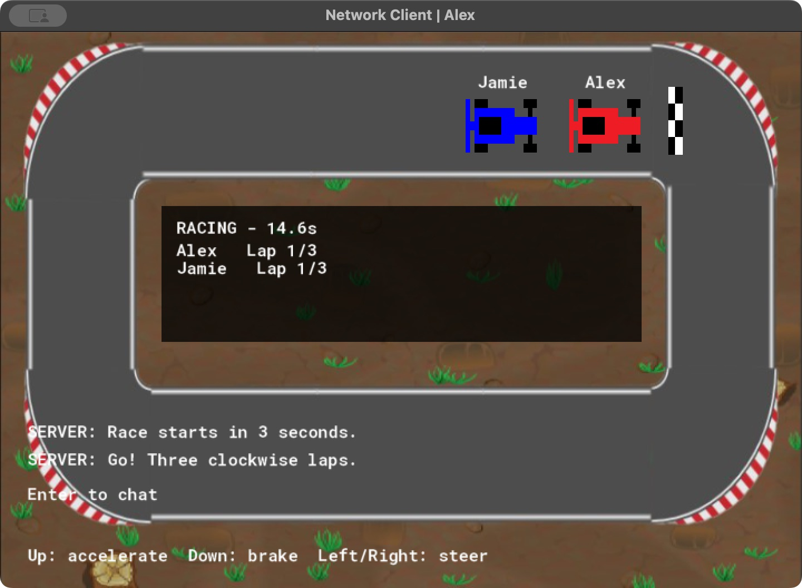
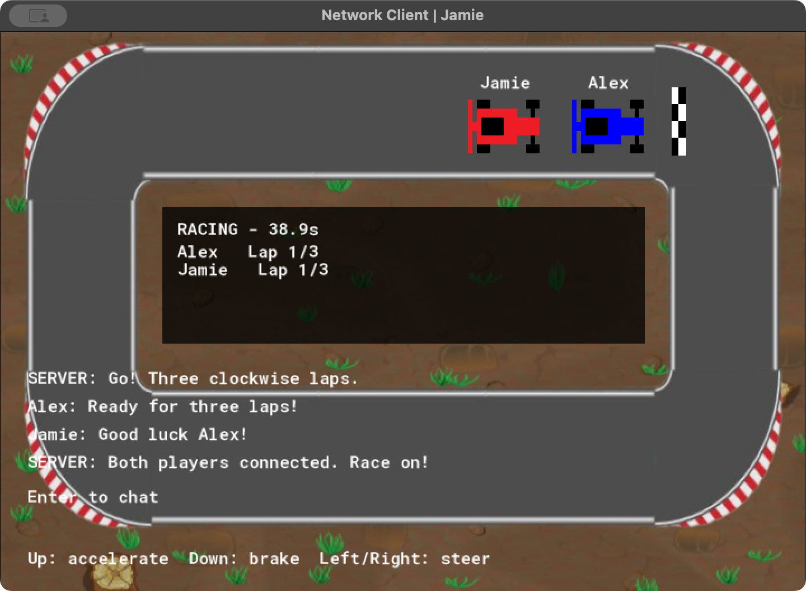
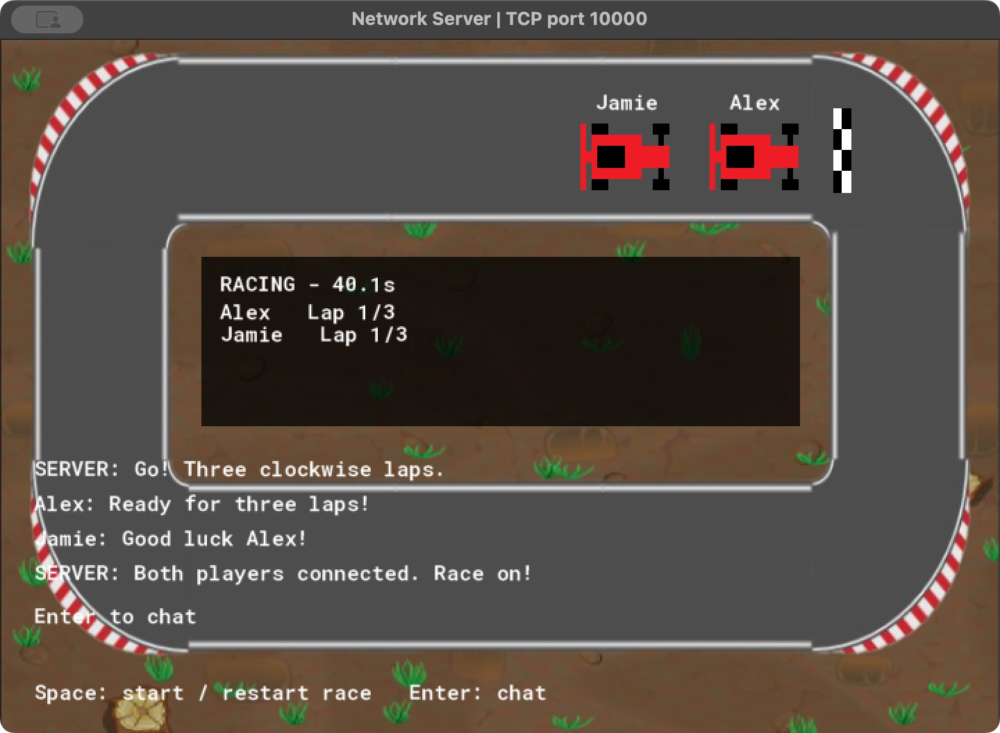

# GameMaker Multiplayer Racing Demo

A top-down racing and chat demo built with **GML and TCP sockets**. The project began in **2022** as an exploration of client–server networking and was updated in **October 2026** to run in GameMaker LTS 2026, with arrow-key driving and a three-lap race system. It retains the original car and track artwork.

A separate server connects up to **five players**, synchronizes their cars and chat messages, and manages the race countdown, checkpoints, laps and finish order.

## Screenshots

The screenshots show the running local macOS build with two demo players.



<details>
<summary>View shared chat and server screenshots</summary>

### Shared chat



### Server view



</details>

## Features

- **Keyboard driving:** hold Up to accelerate, Down to brake, and Left/Right to steer. Releasing the accelerator slows the car; track boundaries stop it.
- **Three-lap races:** the host starts a three-second countdown, then the server checks ordered checkpoints and records each finisher's place and race time.
- **Multiplayer networking:** username handshakes, player joins/disconnects, binary movement updates and socket-to-player maps.
- **Shared chat:** player and host messages, wrapped text and a bounded history.
- **Connection recovery:** clients return to the connection screen if server updates stop, allowing them to reconnect.

## Requirements

The verified build uses:

| Component | Version / target |
| --- | --- |
| GameMaker IDE | LTS 2026.0.0.16 |
| GameMaker runtime | 2026.0.0.23 |
| Compilation | macOS **YYC** native build |
| Tested computer | Apple Silicon, macOS 15.7.3 |
| Configured minimum macOS version | 13.0 |

For the macOS target, install Xcode and GameMaker's native macOS compiler module. Windows and other targets have not been verified for this update. Compiled applications are not included in the repository.

## Getting started

1. Clone or download this repository.
2. Open [SERVER/SERVER.yyp](SERVER/SERVER.yyp) in GameMaker. Select the **macOS** target and **YYC**, then run it.
3. Open [CLIENT/CLIENT.yyp](CLIENT/CLIENT.yyp) in another GameMaker IDE window. Select macOS and YYC, then run it.
4. Enter a username and confirm the dialog. Press **Enter** in the client window to connect.
5. Launch additional client instances if needed, up to five connected players.
6. Focus the **server window** and press **Space**. Driving becomes available when the countdown finishes.

The default connection is **127.0.0.1:10000**, intended for a server and clients on the same computer. Both projects must use the updated protocol; do not mix a 2022 client with the 2026 server.

Mac builds are written under `~/gamemakerstudio2`. For this tested setup, keep the generated applications outside `/tmp`: the runner failed to find its game resources in a temporary bundle path. Use YYC; the VM runner failed before loading the game on the tested Mac.

### Controls

| Window | Key | Action |
| --- | --- | --- |
| Client connection screen | Enter | Connect or retry |
| Client race | Up | Accelerate |
| Client race | Down | Brake; this does not reverse the car |
| Client race | Left / Right | Steer while moving |
| Client or server | Enter | Open chat; press again to send |
| Server | Space | Start or restart the race |

Opening chat stops the local player's car. Empty messages are ignored. The host cannot start a race while typing in chat or during an existing countdown.

### Race rules

1. Players already connected when the host starts are placed on the starting grid.
2. A **three-second countdown** locks driving until the race begins.
3. Drive **clockwise**, visiting the **right → bottom → left** checkpoints in order.
4. Cross the chequered line on the upper straight **from left to right** to complete a lap. Crossing it without all checkpoints does not count.
5. Complete **three laps** to finish. The server records your finish order and race time, then locks your car.

Players who join during a countdown or race wait for the next start. The race ends when no unfinished participants remain; disconnected players are removed. Pressing Space after the countdown can restart the race, reset its timer and laps, and include all currently connected players.

## How it works

The client calculates its own driving movement and sends a binary update every **three game steps**. The server validates the update, records race progress and relays movement to the other clients. It does not echo ordinary movement back to the sender, avoiding stale updates overwriting the driver's current position. Rejected track positions or excessive movement distances receive a correction.

The server also sends race snapshots every **15 game steps**, containing race phase, countdown, elapsed time and player progress. These updates act as a heartbeat: after **five seconds** without server data, a client returns to its connection screen. Restart the server and press Enter to reconnect.

| Source | Responsibility |
| --- | --- |
| [Client player Step](CLIENT/objects/obj_player/Step_0.gml) | Arrow input, acceleration, braking, steering and track checks |
| [Client packet handling](CLIENT/scripts/received_packet/received_packet.gml) | Player instances, movement, chat, race snapshots and corrections |
| [Server packet handling](SERVER/scripts/received_packet/received_packet.gml) | Validation, race setup, checkpoints, finish order and broadcasts |
| [Server Step](SERVER/objects/obj_server/Step_0.gml) | Countdown, race clock, completion and periodic snapshots |
| [Join handling](SERVER/scripts/network_player_join/network_player_join.gml) | New-player setup and existing-player synchronization |

Packets use **32-bit socket IDs** and **32-bit floating-point positions and angles**. Checks cover payload lengths, string terminators, finite numeric values, sender identity, track bounds and movement distance. Incomplete handshakes, duplicate joins and missing instances are guarded. Cleanup events release sockets, buffers, lists and maps.

Usernames are limited to **24 characters**, chat messages to **120 characters**, and stored history to the **latest five messages**. The chat area displays as many wrapped messages as fit. Incoming messages are capped at **1 KiB**.

## Configuration and troubleshooting

- **Change the connection address:** edit `network_connect` in [client creation](CLIENT/objects/obj_client/Create_0.gml). The current address is localhost; LAN play has not been verified.
- **Change the port:** update both the client connection and `port` in [server creation](SERVER/objects/obj_server/Create_0.gml).
- **Server unavailable:** start the server first, confirm the address/port match, then press Enter in the client to retry.
- **Port already in use:** close any other server instance listening on port 10000. The server reports a failed bind instead of continuing without a working socket.
- **Car will not move:** wait for the host's countdown to finish, close chat, and confirm you joined before the race started. Steering requires forward speed.
- **Server connection lost:** restart the server and reconnect each client. The previous race state is not restored after a server restart.

## Scope and validation

This is a small networking demo. Movement remains **client-calculated**, with server checks, rather than a fully authoritative physics simulation. Cars do not collide with one another. Finish results exist only for the current session; there is no persistent high-score database, matchmaking or account system.

Both macOS YYC projects compiled successfully. Runtime checks covered two-player joins, arrow-key movement synchronization, player/server chat, countdown and restart, rejection of a truncated movement packet, and reconnecting after server loss and immediate restart.

A disposable integration-test client crossed the finish line early without receiving a lap, then completed three ordered circuits and received first place:

```text
RACE_TEST_PASS: three ordered laps, first place, elapsed 29.32
```

That driver was a local validation tool and is not included as a playable feature or automated test suite in this repository.

The **2022 version remains in Git history**. The 2026 update migrated the resources, replaced the blocking name prompt with an asynchronous dialog, added racing rules, and corrected the networking and cleanup issues described above.
